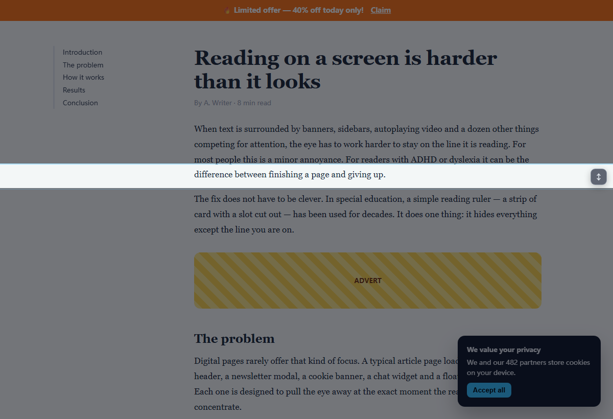

# FocusLine

一条可拖动的阅读线，把周围压暗，只留下你正在读的那一行。

给 ADHD / 阅读障碍用户的浏览器阅读层：无账号、不上传数据、安装时零权限警告、**完全免费**。

> 状态：v0.2.1，功能完整，准备上架；发布清单见 [`docs/RELEASE.md`](docs/RELEASE.md)。

## 开源

FocusLine 以 **MIT** 许可证开源，代码在 <https://github.com/lidachang995599/focusline>。

欢迎 issue 和 PR；只是用的话不需要 GitHub 账号。第三方依赖与许可见 [THIRD-PARTY.md](THIRD-PARTY.md)。



## 功能

- **阅读线**：横条 + 全屏遮罩，上下变暗，只亮当前行；可拖动、可调高度、可调暗度。
- **PDF 阅读器**：弹窗**控件区最上方**的「Open PDF Reader」直接打开内置的 FocusLine Reader——**Chrome 自带的 PDF 查看器扩展改不了，只能自己渲染**。支持远程 PDF 链接、拖拽本地文件、`Open file…`；阅读线、暗度、高度、`Alt + 点击`、`Alt + Shift + L` 固定、吸附到文字行全都可用，文本可以选中复制，**还能用系统本地语音朗读，从阅读线所在句开始**，逐词/整句色彩引导在 PDF 里也能用。
- **跟随鼠标**：开启后线条跟着指针走，不用拖。
- **吸附到文字行**：`Follow cursor` 的进阶模式。指针移到哪一行，线就停到那一行的中心，不用调高度、不用点；指针落在图片或空白上时保持不动，不会乱跳。勾选它会自动打开跟随，因为吸附本质上是“更聪明的跟随”。这是竞品评论区里被点名、开发者答应过却没做的功能。
- **固定到文字行**：`Alt + 左键` 固定、`Alt + 右键` 解除，`Alt + Shift + L` 是键盘等价操作。固定的是**当前那行文字**，不是屏幕坐标：滚动页面时线会跟着这行字一起走，指针和拖拽都不再移动它，键盘微调会把锚点换到新行。页面重渲染导致文字节点消失时，自动退回屏幕固定，不会乱跳。
- **按站点记忆**：每个网站记住自己的位置、高度、暗度和隐藏元素。
- **Calm mode**：停掉页面动画和过渡，减少视觉噪声。
- **隐藏元素**：点一下想隐藏的横幅/浮窗/侧栏，按站点记住。
- **朗读**：用系统本地语音把正文读出来，**从光线所在的词开始**，逐句/逐词高亮；自动按文字脚本选择日语/韩语/中文/页面语音，也可在弹窗里锁定朗读语言；光线跟着当前句走（句在带内不动，句出带或出视口才移），6 种高亮颜色，支持暂停、继续、停止和 0.5–2× 语速；只使用 `localService` 语音，不联网。
- **阅读障碍友好预设**：一键设置 19px 正文、1.7 行高、0.05em 字距、0.16em 词距、65ch 行宽和左对齐。
- **自定义颜色**：五种预设色。
- **色彩引导（默认关闭）**：三档——关闭 / 逐词 / 整句。逐词模式用两种**实色**底交替标记光线所在段落的词（高亮笔效果）；整句模式在段落内**按句交替**使用同样两种颜色，和逐词模式同一套配色。两组颜色都可以在弹窗里用取色器自定义，文字色按亮度自动切黑/白。画在 PDF 上时颜色自动转成半透明。用 CSS Custom Highlight API 实现，不包 `<span>`、不碰页面 DOM。
- **排版调整**：字号（浏览器缩放）、行高、字距、词距、三种阅读主题（纸色/深色/高对比）。
- **按站点自动启用**：常用站点打开就生效，首次需要授权该域名。
- **快捷键**：`Alt + Shift + F` 开关；`Alt + Shift + L` 固定/解除（也可 `Alt + 左键` 固定、`Alt + 右键` 解除）；`Alt + ↑ / ↓` 移动；`Alt + Shift + ↑ / ↓` 调高度。这些键位都可以在 `chrome://extensions/shortcuts` 里改，移动线的两个键位也能在弹窗里直接录制。
- **快捷键速查**：弹窗底部有一块可展开的「快捷键」列表，列出全部手势；移动键那一行会跟着你自定义的组合实时更新，并提示到浏览器的扩展快捷键页面改键。
- **点击定位**：`Alt + 点击`页面任意位置，阅读线直接落到鼠标下面那一行文字上并固定下来（会关掉跟随鼠标）——不用再拖着找位置。**只移动位置，不改线高**，你调好的高度不会被点击覆盖。
- **多语言**：10 种语言，跟随浏览器 UI 语言自动切换，缺省回落英文。
- **可访问性**：滑杆/下拉框有可访问名称；阅读线手柄报告垂直方向与实时百分比；RTL 下数值/单位保持 LTR。
- **界面语言覆盖**：弹窗里的「Language」下拉可以锁定任意一种语言，不跟随浏览器。

所有功能免费，没有 Pro、没有订阅、没有授权码。

## 反馈与联系

扩展本身免费，没有账号、没有内购，也没有赞助入口。有问题或需要新功能，直接发邮件到 `lidachang78@gmail.com`；商店页面和这个 README 里都能找到。

不设打赏的原因：这个工具的技术门槛不高，任何人都能复刻；收费或打赏只会增加安装摩擦、招来差评，所以把「被更多人用上」放在「赚一笔」前面。

## 多语言

内置 10 种语言：英语、简体中文、繁体中文、西班牙语、日语、韩语、法语、俄语、德语、葡萄牙语（巴西）。Chrome 按浏览器 UI 语言自动选择，没有匹配项时回落到英文。

- 文案位置：`public/_locales/<locale>/messages.json`，10 套文件的键名必须一致（有测试保证）。
- **语言选择**：弹窗右上角、开关旁边的下拉框，「Auto」跟随 Chrome UI 语言，其他选项锁定具体语言。选择存在 `chrome.storage.local` 的 `uiLang`，弹窗切换后自动刷新；内容脚本从 `_locales/<code>/messages.json` 读取同一份文案（通过 `web_accessible_resources` 暴露）。**PDF 阅读器也走同一套 `initI18n()`**，打开时读取 `uiLang`，并监听 `chrome.storage.onChanged`，在弹窗里切语言后阅读器会立刻跟着换。
- 新增语言：复制 `public/_locales/en` → 改目录名（`it`、`pl`…）→ 翻译每个 `message` → 在 `src/shared/i18n.ts` 的 `LANGUAGES` 加一行 → 重新构建。
- manifest 的 `name` / `description` 用 `__MSG_extName__` / `__MSG_extDescription__` 占位。
- 页面文案通过 `data-i18n` 属性在运行时替换（见 `src/shared/i18n.ts`），内容脚本里的 HUD 文案用 `chrome.i18n.getMessage`。
- **未覆盖语言会看到英文界面 + 一条英文提示**，引导用户发邮件到支持邮箱；支持语言列表在 `src/shared/i18n.ts` 的 `SUPPORTED_BASES`，加语言时记得同步。
- **商店列表是另一套**：Chrome Web Store 的标题/描述要在开发者后台按语言单独填写，`_locales` 只负责扩展本体和 manifest。见 `docs/STORE.md` 的本地化表格。
- 非英语文案由我生成，**上架前建议找母语者校对商店文案和关键 UI 短句**。
- **切换语言即时生效**：内容脚本监听 `uiLang` 变化并重新加载对应 `messages.json`，已打开的标签页不用刷新。
- **显式选择语言后不会回落到浏览器语言**：缺词时回落到英文，而不是 `chrome.i18n`（它跟的是浏览器 UI 语言，混用会出现「英文界面里蹦出中文」）。

## 快速开始

```bash
npm install
npm run build
```

1. 打开 `chrome://extensions`
2. 打开右上角「开发者模式」
3. 点「加载已解压的扩展程序」，选择本项目的 `dist/` 目录
4. 在任意网页点扩展图标（或按 `Alt + Shift + F`），然后打开弹窗里的开关——**默认是关闭的**，不会点开图标就自动盖住页面

开发命令：

```bash
npm run typecheck   # 类型检查
npm test            # jsdom 冒烟测试（81 项）
npm run dev         # tsc --watch
npm run samples     # 生成本地测试 PDF（samples/，需要系统里的 Arial）
```

## 目录结构

```
src/
  content.ts          内容脚本：覆盖层、拖动、降噪、元素隐藏（自包含，无 import）
  background.ts       service worker：快捷键、自动注入、首次安装打开欢迎页
  popup/popup.ts      弹窗逻辑：滑杆、开关、颜色、联系链接
  shared/types.ts     配置结构、默认值、消息类型
  shared/shortcuts.ts 快捷键组合的解析、格式化、默认值
  shared/chrome.ts    storage / tabs / permissions 的 Promise 封装
  shared/i18n.ts      多语言、语言识别、RTL
  reader/reader.ts    PDF 阅读器页面：pdf.js 渲染、文本层、阅读线、朗读
  reader/speech.ts    朗读用的纯文本工具：语种识别、句子切分（可单测）
public/
  popup.html|css      弹窗
  reader.html|css     PDF 阅读器
  welcome.html|css    首次安装欢迎页
  _locales/           多语言文案（10 种语言）
  icons/              16/32/48/128 图标
scripts/
  clean.mjs           清空 dist
  copy-static.mjs     复制静态资源
  make-icons.py       Pillow 生成图标
  make-samples.mjs    生成本地测试 PDF
test/
  content.test.mjs    jsdom 冒烟测试
  popup.test.mjs      弹窗集成测试
  background.test.mjs service worker 测试
  i18n.test.mjs       多语言与 RTL 测试
  reader-speech.test.mjs  朗读切句与语种识别
docs/                 截图、隐私政策、商店文案、发布清单
```

## 工作原理

**注入方式.** 不使用 `<all_urls>` 的 content_scripts，而是 `activeTab` + `chrome.scripting.executeScript`：只有用户点图标、按快捷键，或对已授权的站点自动启用时才注入。安装时不会出现「读取所有网站数据」的警告。

**覆盖层.** 一个固定定位的横条，用 `box-shadow: 0 0 0 100vmax rgba(...)` 把横条以外的区域一次性压暗——不碰页面布局，不触发重排。整个 UI 放在 Shadow DOM 里，页面 CSS 影响不到它。

**配置.** `chrome.storage.local`，key 为 `site:<hostname>`，值为 `SiteConfig`（见 `src/shared/types.ts`）。弹窗和内容脚本通过消息同步，任一标签页修改后其他标签页即时更新。

**消息协议.**

| 消息 | 作用 |
|---|---|
| `fl:get` | 返回当前状态 `{ host, active, config }` |
| `fl:toggle` | 开关阅读线 |
| `fl:patch` | 合并配置（高度、暗度、颜色、calm、hidden、active） |
| `fl:pick` | 进入元素选择模式 |
| `fl:lock` | 固定 / 解除阅读线位置 |

**降噪.** Calm mode 和隐藏规则优先用构造样式表（`document.adoptedStyleSheets`），遇到不支持或严格 CSP 的页面对回退到 `<style>`。

**语言.** 弹窗选择语言后写入 `uiLang`；弹窗与欢迎页用 `fetch(chrome.runtime.getURL('_locales/...'))` 读取对应文案，内容脚本读同一份文件（`_locales/*/messages.json` 通过 `web_accessible_resources` 暴露）。「Auto」时不加载覆盖，直接用 `chrome.i18n`。

**排版.** 字距覆盖 `body` 及其后代（排除按钮、输入框、图标字体、代码块），`span`/`div` 里的文字也会变；行高作用在 `body` 和正文块级元素上，通过继承覆盖段落。主题只把正文颜色写到 `body`，靠继承生效：深色 cookie 卡、横幅等自己设置了颜色的组件会保留原色，不会被强制改成深色而失去对比度；链接颜色也只在站点未指定时生效。字号用 `chrome.tabs.setZoom`（真正的浏览器缩放，Chrome 按站点记住），而不是改 `font-size`，避免破布局。

**遮罩性能.** 上下变暗用两块 100vh 的纯色面板做 `scaleY()`，而不是给亮带加 `box-shadow: 100vmax`：面板是独立合成层，跟随鼠标时只改 transform，不再整屏重绘。

**朗读.** 内容脚本用 `TreeWalker` 收集 `main/article`（否则 `body`）里的可见文本，按 `Intl.Segmenter` 切句；开始朗读时用 `caretRangeFromPoint(x, 光线 y)` 找到光线下的词，从该词开始读，而不是从页面顶部。朗读语言先看文字脚本：出现假名用 `ja`、谚文用 `ko`、汉字用页面/界面里的 `zh` 或 `ja`；没有脚本信号时用页面 `lang`，最后回退界面语言。弹窗的「Reading language」可以锁定语言，切换时从光线位置重新开始。每句交给 `SpeechSynthesisUtterance`，`onboundary` 的 `charIndex` 映射回原文本节点，用 CSS Custom Highlight API 画句/词高亮。光带已经盖住当前句时**不动**；句子不在带内就把它移到句子中心，句子离开视口时先滚回来——所以线上是跟着朗读进度一句句走的。朗读期间暂停跟随鼠标和吸附，避免指针把线拽走。高亮颜色从弹窗的 6 色里选，句底为 22% 透明度、词底为 58%。语音只保留 `voice.localService === true` 且语言匹配的本地引擎；没有对应语言时明确提示，不会用中文语音念日文汉字。`Esc` 或弹窗里的停止按钮结束朗读。

**阅读预设.** 一次写入 `fontSize=19px`、`lineHeight=1.7`、`letterSpacing=.05em`、`wordSpacing=.16em`、`max-width:65ch`、`text-align:left`；所有值仍可在弹窗里单独改回，`↺` 一键恢复默认。

**快捷键与点击定位.** 移动线的两个键位存在 `chrome.storage.local` 的 `shortcuts`（全局，不按站点），格式固定为 `Ctrl/Alt/Shift/Meta + 键名`，例如 `Alt+ArrowUp`；弹窗录制后写回，内容脚本通过 `chrome.storage.onChanged` 立即生效。只接受 `Ctrl` / `Alt` / `Meta` 组合或 `F1`–`F12`，避免在页面输入时误触发。`Alt + Shift + ↑ / ↓` 保留为固定的调高度手势，不参与录制。`Alt + 点击` 在捕获阶段拦 `mousedown`，用 `caretRangeFromPoint` 取指针下字符的矩形，把亮带**居中到该行**，同时把 `locked` 设为 true——这就是「点哪停哪」。它只改 `y`，不动 `height`：线高是用户手调的结果，不能被一次点击覆盖（早期版本会顺手设成行高的 1.35 倍，结果每次定位都把调好的高度打回去）。

**固定到文字行.** 固定时用 `caretRangeFromPoint` 在亮带中心取一个折叠 `Range` 存进 `anchorRange`；`scroll` 事件里 `syncAnchor()` 读这个 Range 的 `getBoundingClientRect()`，把 `cfg.y` 设成它在新视口里的中心，所以滚轮往下翻时线是**跟着那行字走**的，而不是钉在屏幕坐标上。Range 失效（SPA 重渲染、节点被替换）时 `anchorRange` 置空，退回屏幕固定。键盘微调会先移动再重新取样，锚点落到新行上；PDF 阅读器里的 `locked` 用同一套逻辑，只是文本层来自 pdf.js。

**PDF 阅读器.** `reader.html` 用 pdf.js（构建时从 `node_modules/pdfjs-dist` 拷到 `dist/vendor/pdfjs`）渲染页面：每页一个 canvas 加一个透明文本层（`TextLayer`，负责选中复制和 `caretRangeFromPoint` 命中）。页面按需渲染（`IntersectionObserver`，提前 800px），窗口尺寸变化会重新排版。远程 PDF 通过 `?file=<url>` 打开，读取前先检查 `chrome.permissions.contains`；空状态里也可以直接粘贴链接——`chrome.permissions.request` 必须在提交手势里同步调用，所以那一步放在 `openFromUser()` 的最前面。本地文件走文件选择或拖拽，用 `getDocument({data})`，完全不经过网络。控件不是通栏工具栏，而是右上角一张和弹窗同风格的浮动卡片（`aside#panel`）：高/暗度滑杆、色彩引导与取色、锁定、朗读、打开与关闭；`–` 收起成一个小方块按钮（`#showPanel`），不挡 PDF。卡片里的 `✕` 关闭当前文件，回到空状态并把 `?file=` 从地址栏去掉。扩展的 `Alt + Shift + L` 命令送不到扩展页面，所以由 service worker 用 `runtime.sendMessage` 转发。PDF 的阅读线配置存在 `pdf` 这个 storage key 里，和网页的按站点配置分开。

**PDF 朗读.** 文本层已经在 DOM 里，所以朗读直接从页面的 `.textLayer` 按文档顺序收集文本节点，拼成带偏移映射的字符串；`reader/speech.ts` 用 `Intl.Segmenter` 切句，并按假名/谚文/汉字判断语种，再用本地语音逐句朗读。每句开始时用 CSS Custom Highlight API 高亮对应的 `Range`（`::highlight(fl-pdf-sentence)`），读完清除。**阅读线会跟着当前句移动**：`followSpeechRange()` 取句子的包围盒，句子靠近视口边缘时先 `scrollBy` 把它滚进来，再把 `y` 设到句子中心。朗读是明确的“跟随文本”动作，**优先于锁定**：锁定状态下也会跟，并把锚点刷新到当前朗读行；吸附和指针跟随在朗读期间一律让路。翻到未渲染的页时会先 `await ensureRendered()` 再继续；`Esc`、停止按钮或重新打开文件都会 `cancel()` 并清掉高亮。

**PDF 色彩引导.** 复用同一套 CSS Custom Highlight API：`scheduleGuide()` 以 90ms 节流取阅读线所在页、收集文本层，然后在阅读线的横向 6 个点 × 纵向 3 个点上采样 `caretRangeFromPoint`，把命中的句子去重——双栏 PDF 只取屏幕中心会落在栏间空隙，右栏就永远没有颜色。再用 `Intl.Segmenter` 把句子切成词，交替放进 `fl-pdf-word-a` / `fl-pdf-word-b`；整句模式放进 `fl-pdf-guide-sentence`。颜色来自 `guideColorA` / `guideColorB`，运行时生成到 `#fl-guide-style` 里，并且**必须半透明**——PDF 的字由 canvas 画出、文本层本身透明，实色块会把字形盖住。未渲染的页会先 `ensureRendered()` 再着色，滚动、拖动线、翻页和切换模式都会重算。

**吸附.** 开启 `snap` 后，`onPointerMove` 不再用指针的 `clientY`，而是用 `textLineAt(x, y)` 取指针下字符的行框，把线中心放到 `line.top + line.height / 2`。**滚动时也会重新吸附**：滚轮让指针下的文字换了一行，但指针本身没动，所以 `onScroll` 里会用上一次的指针坐标再取一次行框——这样线是跟着文字走的，而不是停在屏幕坐标上。取不到行框（图片、空白、iframe 内部）时保持原位，避免乱跳。和普通跟随一样跑在 `requestAnimationFrame` 里，每帧最多一次；线高不动，仍由滑杆决定。

## 权限

| 权限 | 为什么 |
|---|---|
| `storage` | 保存每站配置 |
| `scripting` | 在用户点击后注入内容脚本 |
| `activeTab` | 只访问用户当前操作的标签页，无需全站授权 |
| `optional_host_permissions: *://*/*` | 仅在用户勾选「此站自动启用」或打开远程 PDF 时申请单个域名 |

安装时无任何权限警告。扩展不会主动联网：只有用户点「Open in FocusLine Reader」读远程 PDF 时，才会申请该站点的 host 权限并拉取那一份文件；本地文件完全在本地解析。联系按钮是 `mailto:` 链接，点了才会打开邮件客户端。

## 已知限制

- Chrome 自带的 PDF 查看器、`chrome://`、Chrome 应用商店页面无法注入阅读线；PDF 请用内置的 FocusLine Reader 打开。
- 全屏视频/全屏元素会盖住阅读线（浏览器层级限制）。
- 严格 CSP 的页面可能让降噪样式走回退路径，效果一致但实现不同。
- 一根线不能解决所有阅读问题；它只负责「把注意力留在当前行」。
- 吸附和 `Alt + 点击` 都只移动位置、不改线高；线高始终由滑杆/快捷键控制。
- 吸附依赖 `caretRangeFromPoint`，在 canvas 编辑器、图片和空白上取不到文字行，这时线会停在上一行。
- PDF 阅读器不支持表单填写、批注、加密 PDF（需要密码的会报错）；这些交回 Chrome 自带查看器或专业工具。
- PDF 的色彩引导只能用半透明色块（canvas 像素 + 透明文本层，实色会盖住字形）；朗读只有句级高亮，没有逐词。
- 直接打开 `reader.html?file=…` 而没有站点权限时，会提示从弹窗打开；`file://` 的 PDF 需要先在扩展详情里开启「允许访问文件网址」。
- 跟随鼠标在跨域 iframe（YouTube 嵌入、广告位、第三方客服）上会停住：浏览器不会把 iframe 内的指针事件传给父页面。
- 排版调整跟随 FocusLine 总开关：关掉阅读线时，行高/字距/主题也会一起撤掉（字号是浏览器缩放，会保留）。
- 主题会覆盖站点自身的深色模式；在 GitHub/Notion 这类自带主题的站点上建议只用行高/字距，不用主题。
- Google Docs 这类 canvas 渲染的编辑器不受行高影响，只有缩放生效。
- 朗读只用本地语音：系统没有对应语言的 `localService` 语音时会提示并停止，不会拿中文语音去念日文汉字；跨域 iframe 与 canvas 内容不会被朗读。
- 日语/韩语朗读需要在系统里安装对应本地语音（Windows：设置 → 时间和语言 → 语音 → 添加语音；macOS：系统设置 → 辅助功能 → 朗读内容 → 系统声音）。安装后重启浏览器。
- 朗读起点用 `caretRangeFromPoint` 找光线下的词；如果线落在 iframe、Shadow DOM、图片或空白上，会回退到离光线最近的句子。
- 逐词高亮依赖 CSS Custom Highlight API（Chrome/Edge 105+）；旧浏览器仍会朗读，但只有逐句高亮/无高亮。
- 阅读预设会把正文段落、列表、表格单元格设为 19px，并限制 65ch 行宽；对固定宽度的后台表格可能显得偏窄，可随后手动调回。
- **刷新页面后，手动开启的阅读线不会自动回来**：Chrome 不允许扩展在没有站点授权时自动注入。点一次图标即可恢复（状态仍记得）；想彻底自动，勾选「Run automatically on this site」，会请求该域名权限。
- 色彩引导依赖 CSS Custom Highlight API（Chrome/Edge 105+）；不支持时开关无效，不会报错也不会降级成包 `<span>`。
- 色彩引导只处理光线所在的段落（最多 800 个词），不是整页；这样滚动时颜色不会跟着每行闪。逐词模式用两种实色底交替，做不到「每个词一种独立颜色」——颜色数量必须有上限，否则就是噪声。
- 实色底会盖住页面原有的背景色与文字颜色（为了对比度会强制深色文字），暗色主题下视觉冲击比较强；不喜欢就切回「关闭」。
- 自定义快捷键只接受 `Ctrl` / `Alt` / `Meta` 组合或 `F1`–`F12`：裸字母会在输入时误触发，单独 `Shift` 的组合会误伤大写输入。浏览器自己保留的组合（`Ctrl + W`、`Ctrl + T` 等）无法拦截，按下不会生效。
- `Alt + 点击`定位依赖页面把指针事件交给浏览器；少数自绘画布（视频播放器、地图、在线 IDE 编辑器区）拿不到文字行，会退化成「按点击高度放置」。
- 没有做「全页加粗」：长段粗体会降低可读性，需要强调时建议只加粗标题。
- 没有收入，也没有赞助入口，这是免费策略的代价，不是 bug。

## 路线图

- **v0.1.1**：修真实站点上的边角问题；补 5 张商店截图；录 15 秒 demo。
- **v0.1.x（已完成）**：`Alt + 点击`定位、可自定义的移动快捷键。
- **v0.2**：路径级记忆（Jira/Notion 内不同页面）、多套预设。
- **v1.0**：上架 + 20 人 beta + Product Hunt。

## 上架前检查清单

- [ ] 确认联系邮箱可用（`lidachang78@gmail.com`）
- [ ] 隐私政策托管到公网（`docs/PRIVACY.md` 可直接用）
- [ ] 商店文案（`docs/STORE.md`）+ 1280×800 截图（见 `docs/RELEASE.md`）
- [ ] 注册 Chrome Web Store 开发者（一次性 $5）
- [ ] 真实站点回归：GitHub、Notion、Google Docs、新闻站、后台管理
- [ ] PDF 冒烟：arXiv 链接用 Reader 打开、拖入本地 PDF、阅读线/锁定/`Alt + 点击` 都正常
- [ ] 20 人 beta，收集前 7 天留存
- [ ] 失败判据：4 周 3 次分发后安装 < 300，停止加功能

## 验证状态

已通过：

- `tsc` 类型检查零错误
- **81 项自动化测试**：content 37 项（渲染、遮罩、消息、持久化、排版/预设、朗读/起点/起点回退/语言识别/视口跟随/自动开线、跟随鼠标、吸附、跟随暂停、默认关闭、启动竞态、滑块语义、关闭时拾取、开关、降噪清理、Alt+点击定位、固定到文字行、锁定后保留高度、自定义快捷键、色彩引导、自定义引导颜色、实色对比）、popup 26 项（状态绘制、颜色、主题、缩放、朗读控制、朗读语言、高亮颜色、预设、自动启用、语言菜单、快捷键录制、锁定开关、吸附开关、快速连改补齐、色彩引导菜单、引导取色、可访问名称、数值方向、关闭时拾取）、background 6 项（安装页、快捷键、锁定快捷键、自动注入）、i18n 7 项（10 套键名对齐、data-i18n 覆盖、manifest 占位、中文运行时替换、语言识别、RTL 方向、语言菜单完整性）、reader-speech 5 项（语种识别、locale 归一化、中英文句子切分、偏移映射）
- `chrome --pack-extension` 打包成功（manifest 与图标路径合法）
- 无头 Chrome 截图：阅读线遮罩

还没被自动化覆盖：

- **PDF 阅读器的渲染链路没有单测**：pdf.js 需要真实的 canvas 和 worker，jsdom 跑不了。纯文本部分（语种识别、句子切分）已由 `test/reader-speech.test.mjs` 覆盖；渲染、文本层、worker 加载、语音合成仍需本机手测。
- 远程 PDF 的权限申请链路（popup → `chrome.permissions.request` → reader 拉取）。

还需要你在本机跑一次（当前沙箱无法运行有头浏览器，无头模式不接受 `--load-extension`）：

- 点图标 → activeTab 授权 → 注入 → 弹窗消息的真实链路
- GitHub / Notion / Google Docs / 新闻站 / 后台管理页的视觉兼容
- `Alt + 点击` 在真实页面上的贴合度，以及自定义键位与站点自身快捷键的冲突情况
- PDF：arXiv 的 `/pdf/…` 链接（扩展名不是 .pdf，需要从 Reader 页手动输入或拖文件）、拖入本地 PDF、大文件滚动、文本选中复制

**本机验收步骤**：加载 `dist` → 打开任意长文 → 点图标 → 拖动横条 → 刷新页面看配置是否保留 → 按 `Alt + Shift + F` 开关 → 点「Hide an element…」试隐藏元素 → 按住 `Alt` 点一行文字，看线是否贴上去 → 在弹窗里改键位，回页面按新键 → 打开一个 `.pdf` 链接，点图标 → 「Open in FocusLine Reader」→ 看页面是否渲染、线是否跟随、`Alt + Shift + L` 是否锁定 → 点阅读器里的「Read aloud」，确认从线所在句开始读、句子有高亮、`Esc` 能停。

**本地测试 PDF**：`samples/reading-guide.pdf`（4 页，双栏 + 标题 + 页码 + 内嵌 Arial）和 `samples/long-24-pages.pdf`（24 页，测懒加载），由 `npm run samples` 用 pdf-lib 生成。用法：点弹窗底部的「Reader」打开阅读器 → 把 PDF 拖进页面，或点「Open file…」。这台机器访问不了 GitHub，所以没有直接用 pdf.js 仓库里的 `tracemonkey.pdf`；需要更真实的样本可以自己下载后拖进去。

## 联系方式

支持与隐私请求：**lidachang78@gmail.com**

出现在 `docs/PRIVACY.md`、`docs/STORE.md`、`public/welcome.html`、`public/popup.html`。以后换域名邮箱时，全局搜索这个地址替换即可。

> 上架时 Chrome Web Store 需要一个**可公开访问的隐私政策 URL**（不能是本地文件）。免费方案：GitHub Pages 或 Cloudflare Pages 托管 `docs/PRIVACY.md` 转成的静态页。

## 授权

未开源（UNLICENSED）。如果后续需要「可审计」作为信任背书，建议只开源 `src/content.ts` 的渲染与采集逻辑。
